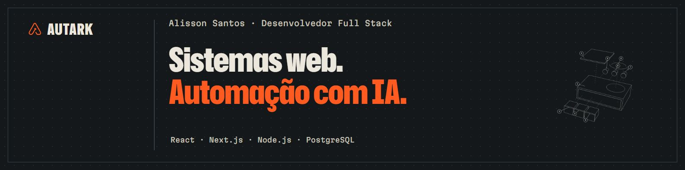
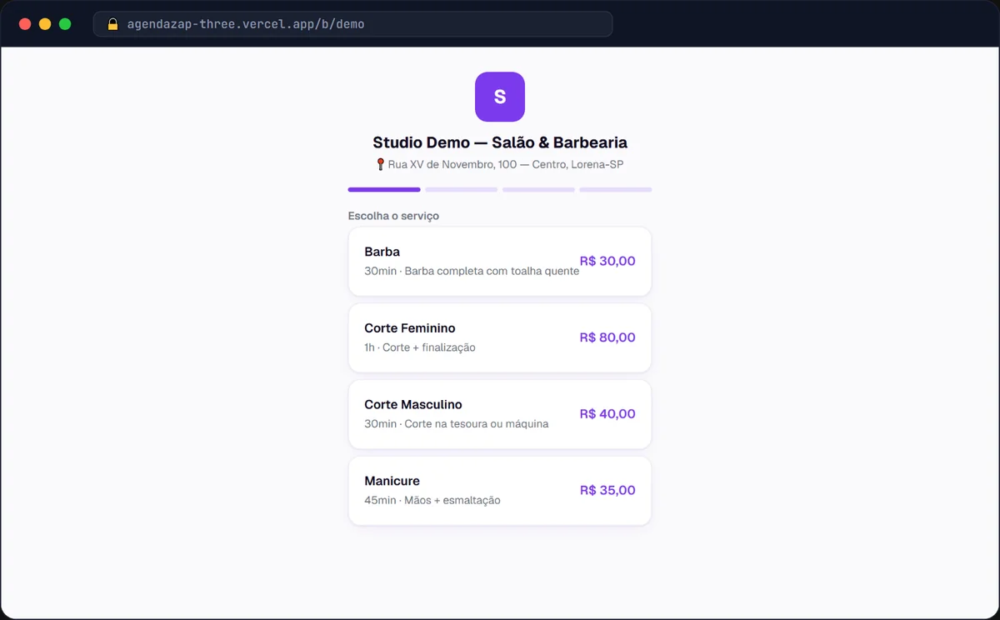
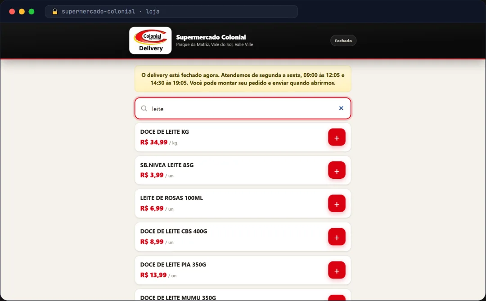
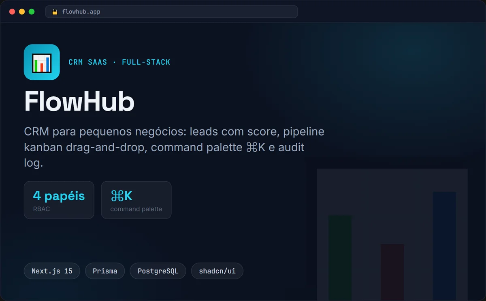
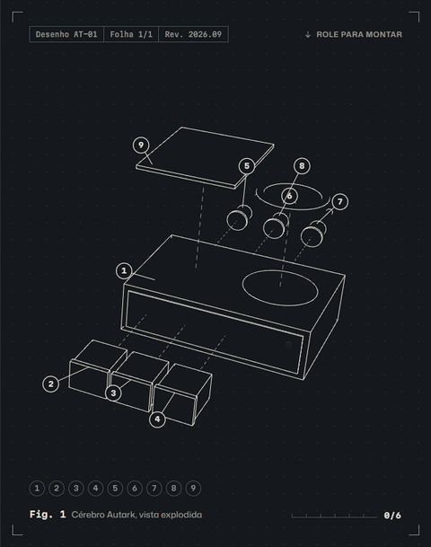

  
  
  
  

Eu sou o **Alisson Santos**, fundador da **[Autark](https://autarktech.com.br/?utm_source=github&utm_medium=perfil)**. Construo sistemas que trabalham sozinhos: atendimento de WhatsApp com IA que vende, atende e agenda a qualquer hora, SaaS completos e integrações que tiram o trabalho manual do seu negócio.

A Autark é uma pessoa só, e é por isso que funciona. Você não passa por agência nem gerente de conta: quem atende, constrói e entrega sou eu. Antes de abrir o editor eu entendo o objetivo de negócio do projeto, hábito que vem da minha formação em Gestão da Tecnologia da Informação.

Lorena, SP · atendimento remoto e por escrito · normalmente das 19h às 00h, todos os dias (Brasília)

## §1 Projetos e sistemas

Entregas para clientes, produtos próprios e demonstrações, com o contexto de cada projeto no [registro do site](https://autarktech.com.br/?utm_source=github&utm_medium=perfil#sistemas). Capturas documentam uma versão do sistema; o acesso a dados de clientes permanece restrito.

<table>
<tr>
<td width="50%" valign="top">

**SYS-01 · AgendaZap**  
SaaS · IA · WhatsApp

Produto próprio de agendamento para salão, barbearia e estética, com demonstração pública. Reúne agenda, página de reservas e recursos de atendimento e lembretes. Integrações externas dependem das credenciais e da configuração de cada operação.

`Next.js 16` `Supabase` `Gemini` `Evolution API` `Mercado Pago`

**[Abrir a demo](https://agendazap-three.vercel.app)** · [testar um agendamento](https://agendazap-three.vercel.app/b/demo)

</td>
<td width="50%" valign="top">

**SYS-02 · CRM de WhatsApp**  
CRM · API oficial da Meta

Inbox e CRM entregue para operação financeira, com governança de templates, opt-out, auditoria e políticas de retenção de dados. A operação foi encerrada pelo cliente. A apresentação do case preserva seus dados e acessos.

`Fastify` `React` `Prisma` `Postgres 17` `BullMQ` `Fly.io`

Filas de processamento · controle de acesso · documentação de operação

</td>
</tr>
<tr>
<td width="50%" valign="top">

**SYS-05 · Bia**  
Delivery multicanal · IA · supermercado de bairro

Delivery entregue para supermercado: catálogo importado do ERP, loja web, Telegram, carrinho, cálculo de taxa e impressão de pedidos. O conector de WhatsApp foi preparado, mas não foi ativado nesse cliente.

`Node.js` `PWA` `Telegram API` `Docker` `ESC/POS`

**Deploy documentado com Docker em VPS Linux, backup e reversão.**

</td>
<td width="50%" valign="top">

**SYS-07 · RealCred+**  
Landing + simulador · crédito consignado

Landing e simulador de crédito consignado, com páginas por modalidade e encaminhamento ao WhatsApp. As regras e fontes ficam identificadas no projeto; a atualização das condições comerciais precisa acompanhar a operação da corretora.

`Vite` `JavaScript` `Netlify Functions` `Schema.org`

Código público · simuladores e páginas responsivas

</td>
</tr>
<tr>
<td width="50%" valign="top">

**SYS-04 · ParkNow**  
Produto próprio · backend de estacionamento

Backend de estacionamento com reservas, atualização em tempo real por Socket.IO e geração de PIX BR Code. O repositório abaixo apresenta a implementação em Node.js, Express e PostgreSQL.

`Node.js` `Express` `PostgreSQL` `Socket.IO` `PIX BR Code`

**[Ver o código](https://github.com/ParkNow914/ParkNow)**

</td>
<td width="50%" valign="top">

**SYS-06 · FlowHub**  
CRM SaaS · código aberto

CRM para pequenos negócios: leads pontuados, pipeline kanban, command palette, quatro papéis de acesso e audit log com o antes e o depois de cada alteração.

`Next.js 15` `TypeScript` `Prisma` `PostgreSQL` `shadcn/ui`

**[Ver o código](https://github.com/ParkNow914/flowhub)**

</td>
</tr>
</table>

<b>Registro completo: os 9 sistemas</b>

 

| Código | Sistema | Tipo | Situação | Ver |
|---|---|---|---|---|
| SYS-01 | AgendaZap | SaaS · IA · WhatsApp | Produto próprio | [demo](https://agendazap-three.vercel.app) |
| SYS-02 | CRM de WhatsApp | CRM · API oficial da Meta | Encerrado pelo cliente | [ficha](https://autarktech.com.br/sistemas/crm-whatsapp/?utm_source=github&utm_medium=perfil) |
| SYS-03 | JurisIA | IA jurídica · SaaS B2B | Produto próprio | [ficha](https://autarktech.com.br/sistemas/jurisia/?utm_source=github&utm_medium=perfil) |
| SYS-04 | ParkNow | Backend de estacionamento | Produto próprio | [código](https://github.com/ParkNow914/ParkNow) |
| SYS-05 | Bia | Delivery multicanal · IA | Entregue | [ficha](https://autarktech.com.br/sistemas/bia/?utm_source=github&utm_medium=perfil) |
| SYS-06 | FlowHub | CRM SaaS · código aberto | Produto próprio | [código](https://github.com/ParkNow914/flowhub) |
| SYS-07 | RealCred+ | Landing + simulador | Entregue | [código](https://github.com/ParkNow914/realcredmais) |
| SYS-08 | Índice de Gestão | Diagnóstico · agronegócio | Entregue | [ficha](https://autarktech.com.br/sistemas/indice-de-gestao/?utm_source=github&utm_medium=perfil) |
| SYS-09 | Acerto | SaaS · crédito consignado | Produto próprio | [ficha](https://autarktech.com.br/sistemas/acerto/?utm_source=github&utm_medium=perfil) |

## §2 O Cérebro Autark

<table>
<tr>
<td width="42%" valign="top">
<picture>
  <source srcset="assets/fig1-montagem.webp" type="image/webp" />
  
</picture>

Fig. 1 do <a href="https://autarktech.com.br/?utm_source=github&utm_medium=perfil#montagem">site</a>, capturada da própria cena 3D

</td>
<td valign="top">

Todo sistema que eu entrego é montado com as mesmas nove peças: um núcleo de regras, as portas de atendimento, os conectores com o que você já usa, a bancada de testes e o fechamento com documentação. Três decisões fazem ele aguentar o mundo real.

**1. Um cérebro, vários canais.** A lógica de negócio fica separada dos canais. Na Bia, a restrição prévia do WhatsApp do cliente levou à entrega pela loja web e pelo Telegram, mantendo o mesmo núcleo de regras.

**2. Validação antes da publicação.** Regras críticas, permissões e integrações recebem testes proporcionais ao projeto. Alterações são verificadas antes do deploy, em ambiente separado dos dados de produção.

**3. Plugado nos seus sistemas.** Conversa com banco, pagamento e agenda, então resolve o pedido em vez de empurrar para um humano.

</td>
</tr>
</table>

## §3 Relatório de campo

Doze avaliações no 99freelas, nota 5.0, 12 recomendações e 12 projetos concluídos, conferidos em 02/11/2026. Três comentários, como os clientes escreveram:

> Excelente profissional. Explica bem tudo.
>
> Página HTML na frente do WordPress · ago. 2026

> Recomendo a todos, um ótimo profissional e de muito conhecimento, sempre atendendo com rapidez todas as demandas solicitadas.
>
> Fluxo para delivery de supermercado · jul. 2026

> Muito prestativo e profissional, sem dúvidas se precisar novamente voltarei a contratar os serviços dele, super recomendo!!!
>
> Landing page para produto low ticket · jun. 2026

<table>
<tr>
<td align="center" width="25%"><h2>5.0 ★</h2>nota no 99freelas, 100% recomendam</td>
<td align="center" width="25%"><h2>12</h2>avaliações no 99freelas</td>
<td align="center" width="25%"><h2>9</h2>sistemas no registro</td>
<td align="center" width="25%"><h2>19h–00h</h2>janela habitual, horário de Brasília</td>
</tr>
</table>

## §4 Ferramentas

<b>O que eu uso no dia a dia</b>

 

**Front-end** · `React` `Next.js` `React Native / Expo` `TypeScript` `Tailwind CSS` `shadcn/ui` `Three.js`

**Back-end** · `Node.js` `Fastify` `Express` `Hono` `Python` `APIs REST` `JWT` `Argon2id`

**Dados e infra** · `PostgreSQL` `Supabase` `Prisma` `Drizzle` `Redis / BullMQ` `Docker` `GitHub Actions` `Fly.io` `Vercel` `Cloudflare`

**Automação e IA** · `n8n` `Evolution API` `Meta Cloud API` `GPT` `Claude` `Gemini` `RAG` `agentes`

**Marketing e dados** · `Google Tag Manager` `GA4` `Meta Pixel` `Conversions API` `SEO técnico` `Core Web Vitals`

<b>Como eu trabalho</b>

 

1. **Diagnóstico.** Briefing por escrito para entender o objetivo, o código existente e as dependências do projeto.
2. **Proposta por escrito.** Escopo, prazo e valor fechados antes de qualquer pagamento.
3. **Entregas visíveis.** Você acompanha versões funcionando ao longo do projeto e aprova cada etapa.
4. **Entrega e suporte.** Publicado, testado e documentado. Depois do lançamento eu acompanho a estabilização.

Trabalho de forma assíncrona, normalmente das 19h às 00h, todos os dias, no horário de Brasília. A dedicação mensal e os prazos são combinados conforme o escopo e a capacidade disponível.

## §5 Assistência técnica

Me conte por escrito o que você quer automatizar ou construir. Retorno na minha janela de atendimento com os próximos passos e exemplos que possam ser compartilhados.

  
  

---

<b>Autark</b> · Manual de Operação · Rev. 2026.11 · <a href="https://autarktech.com.br/?utm_source=github&utm_medium=perfil">autarktech.com.br</a> · <a href="https://github.com/ParkNow914/ParkNow914.github.io">código do site</a>

